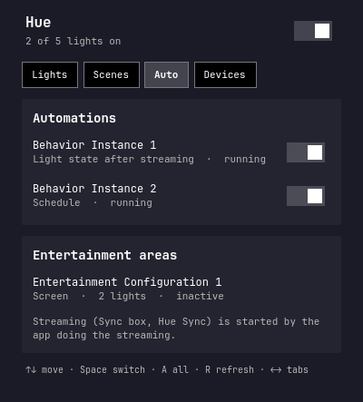

# Hue Lights for Omarchy

Hue Lights is a bar widget for [Omarchy](https://omarchy.org). It controls a Philips Hue system from a panel under the bar.

A small Python backend talks to the bridge. The backend uses only the Python standard library. The QML panel shows the state and sends commands. For more data, read [docs/ARCHITECTURE.md](docs/ARCHITECTURE.md) and [docs/PROTOCOL.md](docs/PROTOCOL.md).

Manifest id: `francisilagan.hue-lights`. Version: 1.0.0.

<p>
  
  
  
</p>
<p></p>

<sub>The screenshots come from the sanitized test fixture. They do not show a real home.</sub>

## Features

- Rooms and zones: set power, brightness, colour, and white temperature for a group or for each light. Create, edit, and delete zones.
- Colour, white, and effects: use the colour picker. Set the white temperature in the range of each light. Use light effects and timed effects. Identify a light (it blinks). Set the power-up behaviour. Rename a light.
- Scenes: recall a scene (active, dynamic, or static). Create a scene from the current look. Save again, rename, and delete a scene. Set the dynamic speed and auto-dynamic.
- Routines: recall and deactivate smart scenes.
- Automations: enable or disable the automations of the bridge.
- Entertainment areas: the panel lists each area with its status. It has a stop button.
- Devices: the panel shows accessories, sensors, battery, firmware update state, and the bridge. The sensors are motion, temperature, light level, contact, and buttons. You can enable or disable motion sensing and similar sensing.
- Wallpaper sync: the backend sets the colour of your lights from the current Omarchy wallpaper.
- Live updates: the backend follows the event stream of the bridge. Changes from the Hue app or from switches show in the panel.

## Requirements

- Omarchy with its Quickshell-based shell and its shell plugins. The widget uses the plugin API (`omarchy plugin`), `KeyboardPanel` from `qs.Ui`, and `Commons.Translations`. The widget is tested on Omarchy 4.5.0. Releases without these parts are not supported.
- `python3` 3.9 or newer. No pip packages are necessary.
- A Hue bridge (v2, CLIP v2 API) on your local network.
- Optional, for wallpaper sync only: ImageMagick (`magick`). For video or GIF wallpapers, also `ffmpeg`.

## Install

Run this command:

```
omarchy plugin add https://github.com/francisilagan/omarchy-hue.git
```

To install the plugin by hand:

1. Clone the repository into your Omarchy plugins directory. The folder name must be the same as the manifest id. The commands `omarchy plugin update` and `omarchy plugin remove` look for `~/.config/omarchy/plugins/<id>`.
2. Let the shell find the plugin.
3. Enable the plugin.

```
git clone https://github.com/francisilagan/omarchy-hue ~/.config/omarchy/plugins/francisilagan.hue-lights
omarchy-shell shell rescanPlugins
omarchy plugin enable francisilagan.hue-lights
```

Add the "Hue Lights" bar widget if it is not in the bar. The default position is the right section.

If you have an older copy in a folder with a different name:

1. Delete that folder.
2. Enable the plugin again.
3. Add the "Hue Lights" bar widget again.

## Update and remove

```
omarchy plugin update francisilagan.hue-lights
omarchy plugin remove francisilagan.hue-lights
```

The remove command deletes only the folder of the plugin. These data stay on your computer:

- Your bridge key and settings: `~/.config/omarchy/hue-lights/`
- The log: `~/.local/state/omarchy/hue-lights/`

To remove the plugin completely, delete these two directories also. The key stays registered on the bridge. To remove the key, use the Hue app.

## Pair with the bridge

Open the widget. If no bridge is paired, the widget shows the pairing view. The view has three methods:

1. **Use my openhue login**: the plugin copies the bridge and the key from the `openhue` CLI config (`~/.config/openhue/config.yaml`).
2. **Find my bridge**: the plugin asks the discovery service of Philips for bridges on your network. This method is opt-in. For details, read [docs/PRIVACY.md](docs/PRIVACY.md).
3. **Manual IP**: type the address of the bridge. Press "Pair with this bridge". Then press the round link button on the bridge within about 40 seconds.

## Use the widget

Use the bar button as follows:

| Click | Action |
|---|---|
| Left | Open the panel. |
| Right | Turn every light on or off. |
| Middle | Refresh. |

Use these keys in the panel:

| Key | Action |
|---|---|
| `↓` or `j`, `↑` or `k` | Move the cursor through the rows of the current tab. The rows are: switches for rooms and zones, chips for scenes and routines, the "N lights" disclosure, the switch of each light, switches for automations and sensors, the wallpaper sync toggles, room chips, and "Sync now". After the first or last row, the keys scroll the panel. On a tab with no rows, they also scroll the panel. |
| `Space` or `Enter` | Operate the row at the cursor. If no cursor shows, turn every light on or off. |
| `←` or `h`, `→` or `l`, `1` to `4` | Show the tab Lights, Scenes, Automations, or Devices. A new tab starts with no cursor. |
| `a` | Turn every light on or off. |
| `r` | Refresh. |
| `Tab`, `Shift+Tab` | Show the next or the previous bar panel. |
| `Esc` | Close the panel. |

When a text field has focus, the field gets every key. A text field is a name or the bridge address. Press `Esc` to give the keys back to the panel.

## Wallpaper sync

The backend watches the link to the current Omarchy background. When the wallpaper changes, the backend does these steps:

1. It reads a palette with ImageMagick. For videos and GIFs, it reads one frame with ffmpeg.
2. It picks up to six different, vivid colours.
3. It assigns the colours to the lights that can show colour and that the bridge can reach. It uses the lights in the rooms you choose. If you choose no room, it uses all rooms.

The backend never changes the brightness.

These options are in the panel:

- Enabled
- Target rooms or zones
- "Also switch lights on"

The default transition time is 2500 ms. The range is 0 to 60000 ms. The panel has no control for the transition time. To change it:

1. Set `transitionMs` under `wallpaper` in `settings.json` (see [Files](#files)).
2. Restart the shell. The backend reads the file only when it starts.

The card in the panel shows this data:

- How many lights the last apply set to a colour, and when it happened.
- How many colour lights the next apply can reach.

"Sync now" applies the colours one time. The palette preview updates also when sync is off.

If sync is on and no light can be reached, the card shows the reason. These are the possible reasons:

- The lights in the selected rooms are off, and "also switch lights on" is off.
- The selected rooms have no colour lights.

If sync is on and the backend cannot read a palette from the wallpaper, the card asks if ImageMagick (`magick`) is installed.

## Languages

The panel follows the language that you select under Setup > Language. The change is live. The panel uses the mechanism of Omarchy (`Commons.Translations`).

The words are in flat JSON catalogs in `qml/i18n/`. There is one catalog for each Omarchy language code. At this time, only English (`en.json`) is available. If a translation does not have a string, the panel uses the English string.

To add a language:

1. Copy `qml/i18n/en.json` to `qml/i18n/<code>.json`. Use a code from `$OMARCHY_PATH/default/i18n/locales.json`, for example `de` or `pt-BR`. A regional file (`pt-BR`) falls back to its base file (`pt`) first. Then it falls back to English.
2. Translate the values. Do not translate the keys. Keep the `%1` and `%2` placeholders. The placeholders can move in the sentence. Keep the brand names (Hue, Philips, openhue).
3. Some entries are objects. These entries are plurals, with CLDR categories as keys. Give the categories that your language uses. German uses `one` and `other`. Russian uses `one`, `few`, and `many`. Japanese uses only `other`. Always give `other`. The panel uses `other` for each category that you omit. The rules are in `$OMARCHY_PATH/shell/Commons/Plural.js`. In these entries, `%1` is the count.
4. Keys such as `effect.candle` and `updateState.installing` name values that the bridge reports. If the catalog does not have an id, the panel shows the word of the bridge.
5. Save the file. The panel reads the catalog again without a restart. Run `python3 tests/qml_smoke.py` to make sure that the views still build.

The bridge and the backend send some text. This text stays in English. It includes sensor readings, error details, and warnings.

## Files

| Path | Contents |
|---|---|
| `$XDG_CONFIG_HOME/omarchy/hue-lights/bridge.json` (0600) | Bridge host, bridge id, application key, pinned certificate fingerprint |
| `$XDG_CONFIG_HOME/omarchy/hue-lights/settings.json` | Wallpaper sync settings |
| `$XDG_STATE_HOME/omarchy/hue-lights/hue.log` (0600) | Rotating diagnostic log |

`XDG_CONFIG_HOME` is `~/.config` by default. `XDG_STATE_HOME` is `~/.local/state` by default.

If the file `~/.config/omarchy/hue-wallpaper.json` exists, the plugin moves its wallpaper settings one time to `settings.json`.

The plugin also reads these two files:

- `~/.config/openhue/config.yaml`, only when you choose "Use my openhue login".
- The symlink `~/.local/state/omarchy/current/background`.

## Development

Run the tests:

```
python3 -m unittest discover -s tests
node --test tests/model.test.js
python3 tests/qml_smoke.py
```

The smoke test renders every view offscreen. It needs `quickshell` and the shell modules of Omarchy (`OMARCHY_SHELL`, default `/usr/share/omarchy/shell`). The test runs in English. Then it switches to a generated test pseudo-locale, which the plugin never ships. The test fails if a catalog string stays untranslated. To keep the PNG files of the test, set `HUE_QML_SHOTS=DIR`.

Put new text for the user in `qml/i18n/en.json`. Read it with `Hue.Strings.t(...)`. The Node tests fail in these cases:

- A key is not in the catalog.
- A catalog entry is not used.

The command `python3 backend snapshot` prints a snapshot from your own bridge. For more data, read [CONTRIBUTING.md](CONTRIBUTING.md).

## Troubleshooting

**The bridge is unreachable.**
The backend tries again with a growing delay. Do these checks:

1. Make sure that the IP address of the bridge did not change. Give the bridge a DHCP reservation.
2. Make sure that you are on the same network as the bridge.
3. Middle-click the bar button, or press `r`, to synchronize again now. If there is no connection, this action reconnects.

If nothing loaded since the shell started, the panel shows a recovery card. The card has two buttons:

- **Retry**
- **Pair with a different bridge**: the plugin forgets the stored bridge and opens the pairing view. Click two times to confirm. In the pairing view, enter the new IP address.

**The certificate changed.**
The bridge shows a different certificate from the certificate that was pinned at pairing. This is normal after a bridge reset or a bridge replacement. If you did not do one of these actions, do not trust the new certificate. Choose "Trust the new certificate" only if you expect the change. If you do not, choose "Forget bridge".

**Unauthorized.**
The bridge rejected the application key. This can occur after a bridge reset. Pair again.

**Other problems.**
Read `hue.log` in the state directory.

## Status and open items

These items are not done:

- Translations other than English (see [Languages](#languages)).
- Right-to-left mirroring.
- Packaging.

The manifest shows no settings. This is on purpose. The plugin has only the wallpaper sync options. The backend keeps them in `settings.json`, and the panel edits them directly. A second copy in the settings of the bar can disagree with the first copy.

## Scripting

These one-shot commands are for scripts, for example a custom bar module, a key binding, or a cron job:

```
python3 backend status
python3 backend toggle
python3 backend room IDS… [--on|--off] [--brightness N]
python3 backend scene ID
```

## License

MIT. See [LICENSE](LICENSE).
