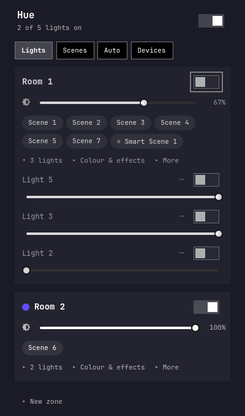
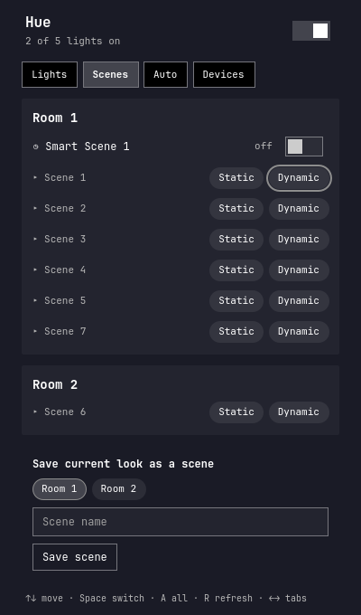
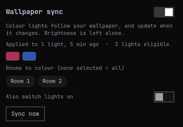

# Hue Lights for Omarchy

A bar widget for [Omarchy](https://omarchy.org) that controls a Philips Hue
system from a panel under the bar. A small Python backend (standard library
only) talks to the bridge; the QML panel only displays state and sends
commands. See [docs/ARCHITECTURE.md](docs/ARCHITECTURE.md) and [docs/PROTOCOL.md](docs/PROTOCOL.md).

Manifest id: `francisilagan.hue-lights`, version 1.0.0.

<p>
  
  
  
</p>
<p></p>

<sub>Screenshots are rendered from the sanitised test fixture, not a real home.</sub>

## Features

- Rooms and zones: power, brightness, colour and white temperature for a whole
  group or per light; create, edit and delete zones.
- Colour, white and effects: colour picker, white temperature within each
  light's range, light effects and timed effects, identify (blink), power-up
  behaviour, rename.
- Scenes: recall (active, dynamic or static), create from the current look,
  re-save, rename, delete, dynamic speed and auto-dynamic.
- Routines: recall and deactivate smart scenes.
- Automations: enable or disable the bridge's automations.
- Entertainment areas: listed with their status, with a stop button.
- Devices: accessories, sensors (motion, temperature, light level, contact,
  buttons), battery, firmware update state, the bridge itself; motion and
  similar sensing can be switched on and off.
- Wallpaper sync: colours your lights from the current Omarchy wallpaper.
- Live updates: the backend follows the bridge's event stream, so changes made
  in the Hue app or by switches appear in the panel.

## Requirements

- Omarchy with its Quickshell-based shell and shell plugins: the widget uses
  the plugin API (`omarchy plugin`), `qs.Ui`'s `KeyboardPanel` and
  `Commons.Translations`. Tested on Omarchy 4.5.0; releases without those are
  not supported.
- `python3` 3.9 or newer (no pip packages).
- A Hue bridge (v2, CLIP v2 API) on your local network.
- Optional, wallpaper sync only: ImageMagick (`magick`), and `ffmpeg` for
  video or GIF wallpapers.

## Install

```
omarchy plugin add https://github.com/francisilagan/omarchy-hue.git
```

Or manually: clone the repository into your Omarchy plugins directory, in a
folder named exactly after the manifest id (`omarchy plugin update` and
`omarchy plugin remove` look for `~/.config/omarchy/plugins/<id>`), then let
the shell find it and enable it:

```
git clone https://github.com/francisilagan/omarchy-hue ~/.config/omarchy/plugins/francisilagan.hue-lights
omarchy-shell shell rescanPlugins
omarchy plugin enable francisilagan.hue-lights
```

Then add the "Hue Lights" bar widget if it is not in the bar yet (it defaults
to the right section). If you had an earlier copy in a folder with another
name, delete that folder first, then enable the plugin again and re-add the
"Hue Lights" bar widget.

## Update and remove

```
omarchy plugin update francisilagan.hue-lights
omarchy plugin remove francisilagan.hue-lights
```

Removing the plugin deletes its folder only. Your bridge key and settings stay in
`~/.config/omarchy/hue-lights/` and the log in `~/.local/state/omarchy/hue-lights/`;
delete those directories too for a complete removal. The key also remains
registered on the bridge until you remove it in the Hue app.

## Pairing

Open the widget; with no bridge paired it shows a pairing view with three ways in:

1. **Use my openhue login**: adopts the bridge and key from the `openhue` CLI
   config (`~/.config/openhue/config.yaml`).
2. **Find my bridge**: asks Philips' discovery service for bridges on your
   network (opt-in, see [docs/PRIVACY.md](docs/PRIVACY.md)).
3. **Manual IP**: type the bridge's address, press "Pair with this bridge",
   then press the round link button on the bridge within about 40 seconds.

## Usage

Bar button: left click opens the panel, right click turns every light on or
off, middle click refreshes.

Panel keys:

| key | does |
|---|---|
| `↓` / `j`, `↑` / `k` | move the cursor through the current tab's rows: room and zone switches, scene and routine chips, the "N lights" disclosure and each light's switch, automation switches, sensor switches, the wallpaper sync toggles, room chips and "Sync now". Past the first or last row (or on a tab without rows) they scroll. |
| `Space` / `Enter` | switch or press the row under the cursor; with no cursor shown, turn every light on or off |
| `←` / `h`, `→` / `l`, `1`-`4` | Lights, Scenes, Automations, Devices (a new tab starts with no cursor) |
| `a` | every light on or off |
| `r` | refresh |
| `Tab` / `Shift+Tab` | next or previous bar panel |
| `Esc` | close |

While a text field (a name, the bridge address) has focus it gets every key;
`Esc` there hands the keys back to the panel.

## Wallpaper sync

The backend watches Omarchy's current-background link. When the wallpaper
changes it reads a palette with ImageMagick (one frame via ffmpeg for videos
and GIFs), picks up to six distinct, vivid colours, and assigns them to the
colour-capable, reachable lights in the rooms you choose (all rooms if none
are chosen). Brightness is never changed. Options in the panel: enabled,
target rooms or zones, "also switch lights on". The transition time (default
2500 ms, 0-60000) has no control in the panel: set `transitionMs` under
`wallpaper` in `settings.json` (see Files); the backend reads that file when it
starts, so restart the shell after editing it. "Sync now" applies once. The
palette preview updates even while sync is off. The card shows how many lights
the last apply coloured and when, and how many colour lights the next one
would reach; if that is none while sync is on, it says why (the lights in
those rooms are off and "also switch lights on" is off, or the rooms have no
colour lights). If sync is on but no palette can be read from the wallpaper,
the card asks whether ImageMagick (`magick`) is installed.

## Languages

The panel follows the language picked under Setup > Language, live, through
Omarchy's own mechanism (`Commons.Translations`). Its words live in flat JSON
catalogs in `qml/i18n/`, one per Omarchy language code; only English (`en.json`)
ships so far, and any string a translation lacks falls back to English.

To add a language:

1. Copy `qml/i18n/en.json` to `qml/i18n/<code>.json`, using a code from
   `$OMARCHY_PATH/default/i18n/locales.json` (`de`, `pt-BR`, ...). A regional
   file (`pt-BR`) falls back to its base (`pt`) before English.
2. Translate the values, never the keys. Keep `%1`, `%2` holes (they may move
   within the sentence) and keep brand names (Hue, Philips, openhue).
3. Entries that are objects are plurals keyed by CLDR category. Supply the
   categories your language uses (`one`/`other` for German, `one`/`few`/`many`
   for Russian, only `other` for Japanese) and always `other`, which is the
   fallback for any category left out; the rules are in
   `$OMARCHY_PATH/shell/Commons/Plural.js`. `%1` there is the count.
4. Keys like `effect.candle` or `updateState.installing` name values the bridge
   reports; an id missing from the catalog shows the bridge's own word.
5. Save: the panel re-reads the catalog without a restart. Run
   `python3 tests/qml_smoke.py` to check the views still build.

Text the bridge or backend sends (sensor readings, error details, warnings)
stays in English.

## Files

| Path | Contents |
|---|---|
| `$XDG_CONFIG_HOME/omarchy/hue-lights/bridge.json` (0600) | bridge host, id, application key, pinned certificate fingerprint |
| `$XDG_CONFIG_HOME/omarchy/hue-lights/settings.json` | wallpaper sync settings |
| `$XDG_STATE_HOME/omarchy/hue-lights/hue.log` | rotating diagnostic log (0600) |

`XDG_CONFIG_HOME` defaults to `~/.config` and `XDG_STATE_HOME` to
`~/.local/state`. Wallpaper settings are migrated once from the older
`~/.config/omarchy/hue-wallpaper.json` if present. The plugin also reads
`~/.config/openhue/config.yaml` when you choose "Use my openhue login" and
the symlink `~/.local/state/omarchy/current/background`.

## Development

```
python3 -m unittest discover -s tests
node --test tests/model.test.js
python3 tests/qml_smoke.py
```

The smoke test renders every view offscreen and needs `quickshell` plus
Omarchy's shell modules (`OMARCHY_SHELL`, default `/usr/share/omarchy/shell`).
It runs in English, then switches to a generated test pseudo-locale (never
shipped) and fails if any catalog string is left untranslated; set
`HUE_QML_SHOTS=DIR` to keep its PNGs. New user-visible text goes in
`qml/i18n/en.json` and is read with `Hue.Strings.t(...)` (the Node tests fail on a
key the catalog lacks, or a catalog entry nothing uses).
`python3 backend snapshot` prints a snapshot from your own bridge. See
[CONTRIBUTING.md](CONTRIBUTING.md).

## Troubleshooting

- **Bridge unreachable**: the backend retries with backoff. Check that the
  bridge IP has not changed (give it a DHCP reservation) and that you are on
  the same network. Middle-click the bar button or press `r` to resync (or,
  with no connection, reconnect) now. If nothing has loaded since the shell
  started, the panel shows a recovery card with **Retry** and **Pair with a different bridge** (two clicks: it forgets
  the stored bridge and opens the pairing view, where you can enter the new IP).
- **Certificate changed**: the bridge presented a different certificate from
  the one pinned at pairing. This is normal after a bridge reset or
  replacement; if you did not do either, do not trust it. Choose "Trust the
  new certificate" only when you expect the change, or "Forget bridge".
- **Unauthorized**: the bridge rejected the application key (for example after
  a bridge reset). Pair again.
- Anything else: look at `hue.log` in the state directory.

## Status / not yet

Not done: translations other than English (see Languages), right-to-left
mirroring, and packaging. The
manifest exposes no settings on purpose: the only options the plugin has are
the wallpaper sync ones, which the backend keeps in `settings.json` and the
panel edits directly; a second copy in the bar's settings would disagree with it.

## Scripting

`python3 backend status | toggle | room IDS… [--on|--off] [--brightness N] | scene ID`
are one-shot commands for scripts (a custom bar module, a key binding, a
cron job).

## License

MIT, see [LICENSE](LICENSE).
